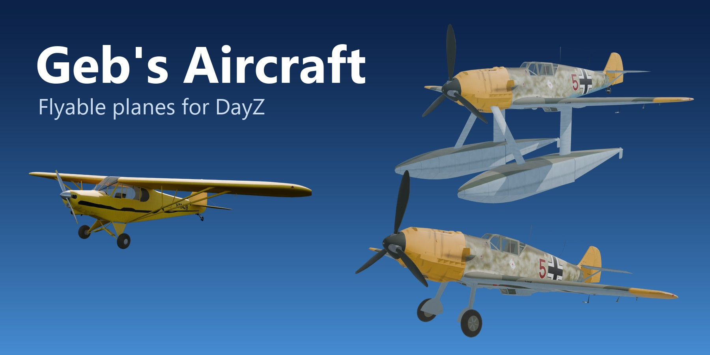

<h1 align="center">
  <br>
  <a href="https://packjc.github.io/gebsaircraft/"></a>
  <br>
  <a href="https://discord.gg/G8uSGZ8yyf"></a>
  <br>
</h1>

<h3 align="center">Flyable Aircraft for DayZ</h3>

<p align="center">
  
  
  <a href="https://packjc.github.io/gebsaircraft/"></a>
</p>

<p align="center">
  <a href="https://packjc.github.io/gebsaircraft/">Website</a> •
  <a href="#information">Information</a> •
  <a href="#key-features">Key Features</a> •
  <a href="#how-it-works">How It Works</a> •
  <a href="#flying-the-cub">Flying</a> •
  <a href="#server-setup">Server Setup</a> •
  <a href="#classnames">Classnames</a> •
  <a href="CHANGELOG.md">Changelog</a> •
  <a href="#credits">Credits</a> •
  <a href="#license">License</a>
</p>

## Information

DayZ has no aircraft. Geb's Aircraft adds them, on a realistic flight model and in multiplayer:

* the **Piper PA-18 Super Cub**, a two-seat tandem bush plane that takes off from a field and lands again;
* the **Messerschmitt Bf 109 E-3**, the single-seat fighter of 1940, with retractable gear, flaps, slats, a constant-speed propeller and a working cockpit (no guns yet);
* the **Bf 109 W**, the same fighter on twin floats, flying from the sea and the lakes;
* the **Super Cub on floats**, flown arcade: the easy one. It takes off by itself, flies itself straight and level, banks into turns without rudder and can't stall or spin.
* the **Heinkel He 162 A-2**, a single-seat early jet with a dorsal BMW 003 engine, retractable tricycle gear and a working cockpit. This new aircraft is pending live flight verification.

The Cubs and Bf 109s also come in **winter** and **desert** camouflage. The He 162 has one worn late-war camouflage, without swastikas. The [website](https://packjc.github.io/gebsaircraft/) has flying notes, server setup and classnames.

## Key Features

- **A real flight model:** every wing panel and tail surface gets its own airflow, so rolling, yawing and the stall come out of the air itself. A wing that stalls first drops and can spin the plane
- **Propellers with character:** thrust that falls off with speed, torque that rolls the plane, a corkscrew slipstream on the fin, and on the 109 the propeller's gyroscopic kick
- **Wheels and floats:** sprung wheels that grip up to their load, a steering tailwheel and toe brakes; floats simulated in slices, with buoyancy, planing on the step, the hump of the takeoff run, water rudders, spray and the sound of the water
- **Engines and fuel:** start them with the start action, run them on their own tanks, refill them from a jerrycan; crashes damage the engine or the airframe where they hit, and a propeller in the water drowns the engine
- **The 109's cockpit:** fifteen German instruments with moving needles, a stick, pedals, throttle and flap wheel that move, gear lamps, and an inertia starter you hear wind up
- **The He 162:** jet thrust and turbine spool-up, three removable wheels, animated cockpit controls and eight instrument faces with nine moving needles; an orange exhaust flame that grows with the throttle, with heat haze
- **An instrument panel on the HUD** in place of a car's speedometer
- **Arcade flying** for the Cub on floats: the keys ask for turn rates and the plane flies itself
- **Winter and desert camouflage** for the Cubs and Bf 109s, the floats painted to match
- **Smooth in multiplayer:** the server and the pilot's machine fly the same plane
- **Standalone:** no Community Framework, no other mods

## Requirements

- DayZ 1.30
- None. No Community Framework, no other mods. Load it on the server and every client.

## How It Works

A plane is a bare `Transport`. [scripts/4_world/entities/vehicles/gebsplane.c](scripts/4_world/entities/vehicles/gebsplane.c) makes its physics body and simulates all of it, every physics step:

* **The wheels** ([gebsplanewheel.c](scripts/4_world/entities/vehicles/gebsplanewheel.c)). Each casts a ray to the ground from its hub, rides a spring and damper, and grips up to what its load allows: sideways so it doesn't skid, along the wheel to roll and brake. The tailwheel steers on the rudder pedals, its swing narrowing as the speed builds. At a crawl the rudder also brakes the main wheel on its side, as a Cub pilot's toe brakes do. The main wheels are ordinary car wheel items: a damaged one is smaller and grips less, a missing one leaves the plane on its hub.
* **The floats** of a floatplane ([gebsplanefloat.c](scripts/4_world/entities/vehicles/gebsplanefloat.c)). Each float is cut into twelve slices along it, each a vee bottom with upright sides. A slice under the water is buoyed up by what it displaces. Moving, its bottom planes: the water pushes it back out as hard as the bottom meets it, so up on the step a little of each float carries the plane. It also makes waves (the hump of the takeoff run), drags with its skin and grips sideways like a keel. Up on the step the water breaks away behind the step and the afterbody runs dry. A water rudder on each float turns with the pedals.
* **The engine.** Off, cranking on the starter, or running on its fuel. Its power follows the throttle with a lag, and it stops when it is switched off, runs dry or is ruined.
* **Lift and drag on each surface.** The wing is four panels, plus the tailplane and the fin. Each one gets the airflow at its own point, so the motion damps itself the way a real plane's does:
  * rolling makes one wing meet the air harder than the other
  * yawing swings the tail into the wind
  * a panel that passes its stall angle loses its lift, so a wing that stalls first drops and can start a spin
* **The wing's downwash** over the tailplane, and **ground effect** close to the ground or the water.
* **The propeller.** Its thrust falls off with airspeed. Its torque rolls the plane left, and its corkscrew slipstream hits the fin, so the takeoff run needs right rudder. A dead engine's propeller windmills and drags.
* **The He 162's turbojet** ([gebshe162.c](scripts/4_world/entities/vehicles/gebshe162.c)). Its turbine spools with the throttle and produces direct thrust, with no propeller torque or slipstream. Its flight coefficients are an initial simulation approximation pending live testing.
* **Arcade flying**, for a plane whose config turns it on (`GebsFlight Arcade`; the Cub on floats). The stick and pedals ask for turn rates, and the assist turns the plane at them, as Alien Invasion's UFO's drive does, taking over the air's own turning moments while the wings still lift and drag. Let go, the wings roll level and the flight path eases level. Banked, the nose follows the turn round without rudder. Near the stall the nose comes down by itself, and a held pull climbs only as steeply as the speed keeps up.
* **Fuel** in its own tank, filled from a jerrycan with vanilla's refuel action. **Crashes** damage the engine or the airframe, wherever they hit.
* **No weather wind, for now.** The server and the pilot's machine each keep their own copy of the weather, and a plane flown on two different winds drifts apart between them (see Multiplayer). `windScale` in `GebsFlight` brings it back.
* **An instrument panel** on the HUD ([scripts/5_mission/gui/gebsplanehud.c](scripts/5_mission/gui/gebsplanehud.c)) in place of a car's speedometer.

Everything a plane is made of lives in its config's `GebsFlight` class, with the positions of its surfaces, wheels, floats, thrust line and door as memory points in its model. The He 162 adds a turbojet subclass to the shared aircraft simulation.

**Multiplayer.** As with every DayZ vehicle, the pilot's own client simulates the plane, and the server simulates it too from the same moves, correcting the pilot's machine wherever the two part company. Each correction is a jolt, so the simulation has to come out the same on both:
* the pilot's controls ride in the vehicle's network move, and the engine's switches are thrown on both machines at once;
* the engine's state rides in the owner state a correction rewinds;
* every force goes in through `Transport.ApplyForceAt`, the engine's deterministic physics that a correction replays, at points taken from the physics body's own position;
* nothing reads what each machine keeps its own copy of, such as the weather's wind.


## Flying the Cub

| Key | Does |
| --- | --- |
| W / S | Stick forward (nose down) / back (nose up) |
| A / D | Roll left / right |
| Z / C | Rudder left / right, which also steers the tailwheel on the ground |
| Shift / Ctrl | Throttle up / down. The lever stays where you leave it |
| X / R | Flaps down / up a notch (up, half, full) |
| Page Up / Page Down | Trim nose up / down |
| Space | Wheel brakes |

All of them can be rebound under Settings > Controls > Geb's Aircraft. There are no gears. The rest are the usual vehicle actions:

| Action | Key |
| --- | --- |
| Start the engine | hold the left mouse button until it fires |
| Stop the engine | click the left mouse button |
| Open / close the door, outside or from the seat | F |
| Get in / get out (the door or canopy opens by itself; get out only when stopped) | hold F |
| Eject, when moving with the door or canopy open | hold F |

* **Getting in.** Stand anywhere near the cabin, look at the plane and hold F: the door opens by itself. Look at the back seat to sit as passenger; otherwise you get the first free seat, the pilot's first. From either seat you can open and close the door.
* **Starting.** Hold the start action. The starter turns the propeller over and the engine fires after a second or so. It needs fuel and an engine that isn't ruined; if it won't fire, the script log says why. A Cub has no battery or spark plugs to find.
* **Taxiing.** Standing still with the throttle shut and the pedals centred, the brakes hold it. Open the throttle a little to roll, and steer with Z and C: the tailwheel steers, and at a crawl the rudder also brakes the wheel on that side for tight turns.
* **Takeoff.** Half flaps, full throttle, and keep it straight with the rudder as it speeds up. Hold S: the stick stops short of the stall by itself, and it lifts off at about 90 km/h and climbs away. Left alone, it flies off at about 105 km/h with half flaps.
* **In the air.** It climbs at about 5 m/s, cruises at 160-180 km/h and tops out around 200 km/h. Clean, it stalls at about 74 km/h, or 69 km/h with full flaps. Pull too hard and a wing drops.
* **Landing.** Full flaps, about 80 km/h on the approach, throttle to idle over the field. Touch down on all three wheels and brake gently: a Cub braked hard noses over onto its propeller. Stopped with the throttle shut, the brakes hold it.
* **Refuelling.** Stand by the left side of the cabin with a jerrycan of fuel and look up under the wing root. The tanks hold 136 L, and the HUD shows what is left.
* **Getting out.** Stop the engine first, or it stops when you leave the seat. You climb out at the door. Get out is only there once the plane has stopped (under 8 km/h).
* **Ejecting.** Moving, open the door (F) and hold F to eject. In the air you fall from beside the door, so bring a parachute; on the ground it hurts as jumping out of a moving car does.

## Flying the Bf 109

The keys are the Cub's, and one more:

| Key | Does |
| --- | --- |
| G | Landing gear up / down |
| X / R | Flaps down / up a step (0, 10, 20, 30, 42°): the handwheel turns them slowly, 8 s all the way |
| Page Up / Page Down | Trim: the whole tailplane turns |

* **Getting in.** Stand anywhere within about 3.5 m of the cockpit, on either side or up on the wing, look at the plane and hold F. The canopy opens by itself (it is hinged on its right and swings over). Close it from the seat before you take off.
* **Starting.** Hold the start action: the inertia starter's flywheel winds up for three seconds, then engages and turns the engine over, and it fires about four seconds after you began. You can let go once the action has finished; it carries on by itself. With no fuel, or a ruined engine, it turns over and doesn't fire, and the script log says why.
* **The panel.**
  * Upper left: altimeter. Lower left: airspeed (km/h).
  * Middle: turn and slip, with the compass below it; the variometer is above them.
  * Right: rpm, with the boost (ata) below it.
  * The small dials: fuel, the clock (game time) and the propeller pitch clock.
  * Along the bottom: fuel and oil pressure, brake pressure, coolant and oil temperature, the ammeter.
  * The gear lamps sit by the clock: green when down and locked, red when up.
* **Takeoff.** This is the part a 109 is known for, and here too:
  * Set half flaps (two presses of X). Open the throttle smoothly over a few seconds (Shift) and keep it straight with Z and C. The tailwheel steers at a crawl and the rudder takes over as speed builds.
  * Keep it straight with taps on the rudder, not long presses. On the run the slipstream makes the rudder strong, and with the wing carrying half the weight the narrow gear rocks easily.
  * Don't touch the ailerons yet. Sitting on its tail, the wing is close to its stall, and an aileron put down there drags the nose round.
  * At about 100 km/h ease the stick forward (W) to bring the tail up, the nose just above the horizon.
  * Around 150-160 km/h ease back (S) and it flies off. The run is about 390 m.
  * Leave the stick alone and it gets there too, more slowly: on a quarter flap the tail comes up by itself from about 130 km/h and it flies off at about 200.
  * Don't take off on full flaps: it lifts off right at its stall and drops a wing. Half or less, as the real one did.
  * Pushing the nose well below the horizon on the run puts the propeller into the ground.
* **The stick on keys.** A tap of W or S is a nudge. Held, S pulls steadily and stops short of the stall, as a pilot's hand stops at the first shudder: the pull slows as the wing nears its stall or the g nears 6, and holds there. So holding S after lift-off climbs it away, holding S in a turn pulls the turn as tight as it will go, and neither drops a wing. Let go and the stick eases back to the middle. Stalling it takes slowing down with the stick held back, as in a real one. `stallMargin` and `pullG` in `GebsFlight` set where it stops; 0 turns that off.
* **In the air.**
  * Gear up (G) once you are climbing: it won't fold while the wheels carry the weight.
  * Best climb is about 270 km/h, about 16 m/s at full power. It cruises at 350-400 km/h at half throttle and tops out around 480 km/h low down.
  * Trimmed at cruise it flies itself, wings level.
  * The slats slide out by themselves near the stall.
  * It stalls at about 145 km/h clean and 130 with full flaps, a wing dropping as it goes. It rolls about 110° a second at 400 km/h.
* **Landing.** Gear down (the green lamp) and full flaps below 250 km/h. Approach at 170-180 km/h and hold off to a three-point touchdown at about 140. Held S stops short of the stall here too, so it may settle on its main wheels first, the tail coming down as it slows. The brakes are strong and the gear narrow, so steer with the rudder and brake gently.
* **Getting out.** Stop the engine (click), then hold F. The canopy opens by itself, and you come out on the left, just behind the wing. To leave it moving, open the canopy (F) and hold F to eject, as from the Cub.
* **Refuelling.** The filler is on the left side behind the cockpit (the yellow triangle). Stand there with a jerrycan. The tank holds 400 L, about an hour at full power.

## Flying the He 162

`GebsHe162A2` is the single-seat Heinkel He 162 A-2 in one late-war camouflage. It uses the shared aircraft controls and a BMW 003-style turbojet. **Live flight verification is pending:** takeoff, landing and performance figures have not been established in DayZ.

| Key | Does |
| --- | --- |
| W / S, A / D | Pitch and roll |
| Z / C | Rudder and nose-wheel steering on the ground |
| Shift / Ctrl | Throttle up / down; allow time for the turbine to spool |
| G | Retract / extend all three landing-gear legs |
| X / R | Flaps down / up a notch: up, half, full |
| Page Up / Page Down | Nose-up / nose-down trim |
| Space | Main-wheel brakes |
| F / hold F | Open or close the canopy / get in or out using the shared aircraft actions |

* **Getting started.** Spawn it on clear, level ground and fit two `GebsHe162_Wheel` main wheels and one `GebsHe162_NoseWheel`. A debug spawn supplies all three wheels, full fuel and an open canopy. Hold the usual start action to complete the starter cycle, then close the canopy before taxiing.
* **The panel.** Eight faces show airspeed, altitude with separate metre and kilometre hands, climb/descent, heading, turbine rpm, fuel, exhaust temperature and oil pressure. The stick, pedals, throttle, flap control and gear lever move with the controls.
* **The gear.** G operates the main legs and nose leg together, with their doors. The shared gear system prevents retraction while the wheels carry the aircraft's weight; extend it before landing and confirm the down indication.
* **Exhaust.** The BMW 003 has no afterburner. An orange flame jet, modelled on the camping stove's flame, shoots from the nozzle and lengthens with the throttle, with heat haze and a warm glow on the tail.
* **Taking off.** Its thrust and lift are tuned up for DayZ's short airfields. Set half or full flaps (X), run the throttle up to full and let the turbine spool, release the brakes, and pull back gently from about 130 km/h. It should lift off in roughly 400 m.
* **Fuel and parts.** The configured tank holds 695 L. The main and nose wheels are different items; fit them to their matching inventory slots. The existing jerrycan refuelling and aircraft damage/persistence systems apply.

## Flying the Bf 109 W on Floats

The E-3 on twin floats (`GebsBF109W`), after a photo of a 109 on floats: its gear folded away for good, a float under each wing on one broad strut, braced forward to the engine by a slimmer one, a water rudder on each float's tail. Everything in the cockpit is the E-3's, and so are the keys, except there's no gear to work (G does nothing, both gear lamps stay dark) and no wheel brakes. It weighs 2,790 kg, about 290 more than the E-3.

* **Where.** The sea, or a lake long enough: the takeoff run is about 850 m. It can't use a runway. On land it rests on its floats and won't move far.
* **Getting in.** From a jetty, a beach or the shallows, as the E-3. Swimming alongside works too: hold F within about 3.5 m of the cockpit. Getting out on the water drops you in it.
* **Afloat.** It sits about half a metre deep, nose a touch up, the propeller tips about 0.7 m clear of the water. It rocks back level if tipped.
* **Taxiing.** There are no brakes on the water. At idle it creeps along at about 6 km/h. The rudder keys also turn the water rudders, which work up to about 45 km/h.
* **Takeoff.**
  * Half flaps (two presses of X). Hold S and open the throttle all the way.
  * The bow rises over the hump at 30-40 km/h, the water dragging hardest there.
  * From about 60 km/h it's up on the step and runs lighter. Holding S here eases the stick to the planing attitude by itself, about 6° nose up, and keeps it there. `stepPull` in `Floats` sets the stop.
  * It comes off the water at about 170 km/h, some 850 m and 35 s from the start. With S held it then climbs away.
  * Leave the stick in the middle and it planes too flat and never gets off. Nose-up trim (Page Up) with the stick left alone gets off as well.
* **In the air.** Slower and heavier than the E-3: about 400 km/h flat out low down and a climb of about 9 m/s at 270 km/h.
* **Landing.**
  * Full flaps, 165-170 km/h on the approach, throttle to idle.
  * Touch down in the planing attitude, about 6° nose up, sinking slowly. Hold that attitude while it runs on the step, then ease the stick back below about 90 km/h as it settles.
  * Don't pull back while it's still fast: it skips off the water, and pulling then stalls it and drops a wing.
  * Coming down at more than about 5 g damages the airframe (`slamLoad`). Putting the propeller under the water stops the engine and costs it a quarter of its health.
* **A wreck sinks.** A ruined plane's floats flood, and it settles slowly and goes down.

## Flying the Cub on Floats

The Super Cub on twin floats (`GebsPA18F_Yellow`, `_Winter`, `_Desert`), flown arcade: the easy plane. Its landing gear comes off for floats on struts from the gear's fittings, tied together across by spreader bars, with a water rudder on each. It has a 180 hp engine, as many float Cubs do, and weighs 767 kg. The keys are the Cub's, but they work differently:

| Key | Does |
| --- | --- |
| W / S | Pitch down / up, at a steady rate while held. Let go and it eases back to level flight |
| A / D | Bank left / right, up to 60°. Let go and the wings roll level |
| Z / C | Turn on the water; a little yaw in the air (you don't need it in turns) |
| Shift / Ctrl | Throttle |
| X / R | Flaps (optional: half flaps shortens the takeoff a little) |

* **Where.** The sea or a lake. It can't take off from land: on land it rests on its floats.
* **Getting in.** As the Cub, through the door on the right, from a jetty, the shallows or swimming alongside.
* **Afloat.** It sits about 0.3 m deep, a little nose up, the propeller tips about 0.6 m clear of the water.
* **Taxiing.** Z and C turn it on the spot, about 30° a second. At idle it creeps along at about 6 km/h.
* **Takeoff.** Open the throttle all the way and let go of everything. It gets up on the step and lifts off by itself at about 110 km/h, some 260 m and 18 s later, and flies on level just above the water. Hold S as it goes and it's off sooner, at about 100 km/h after 200 m, and climbs away.
* **In the air.**
  * Hands off, it flies straight and level at any throttle, holding its height. The throttle sets the speed: about 200 km/h flat out, 135 at 40%.
  * Hold S to climb: it settles into about 5 m/s at 95 km/h. Let go to level off.
  * Hold D (or A) to turn: it banks to 60° and turns about 20° a second, keeping its height. Let go and the wings are level in about 2 s.
  * Hold W to dive, at most 40° steep. Let go and it pulls out by itself.
  * It can't stall or spin. Slow, the nose comes down by itself and it mushes along, wings level.
* **Landing.** Close the throttle and let go. It slows to about 85 km/h and settles towards the water at about 1.5 m/s, wings level, and lands by itself. Holding S for the last few metres makes it a little softer.
* **Tuning.** `class Arcade` in its `GebsFlight` (`data/config.cpp`): the rates at full stick, how fast it levels, the bank limit, the climb and dive limits, the stall margin and the water attitude. Another plane gets the same assist by adding the class to its `GebsFlight`.

## Server Setup

1. Load the mod with `-mod=@gebsaircraft` on the server and every client, and copy its `.bikey` into the server's `keys` folder.
2. Add the planes to `db/types.xml` and their wheels to `cfgspawnabletypes.xml`. Ready-made entries for every plane, scheme and wheel are on the website: [types](https://packjc.github.io/gebsaircraft/server/gebsaircraft-types.xml), [spawnable types](https://packjc.github.io/gebsaircraft/server/gebsaircraft-spawnabletypes.xml).
3. The planes have no spawn points yet (nominal 0). Place them with admin tools, or give them an event of their own at the airfields. A new plane comes with half tanks. A debug spawn supplies the removable wheels, full tanks and an open door or canopy; the He 162 needs two main wheels and its separate nose wheel. COT's own spawner doesn't call this for a plane, so a COT spawn has the half tanks.

The He 162's economy entry is `GebsHe162A2`. Add two guaranteed `GebsHe162_Wheel` attachment entries and one `GebsHe162_NoseWheel` entry in `cfgspawnabletypes.xml`; the supplied download includes all three. Keep the new jet on a test server until its live flight checks are complete.

In COT, spawn a plane with the health at full (1200) or left empty. COT applies the health field after spawning, so a health of 0 gives you a ruined plane: it looks the same, opens its door and takes a pilot, but its engine never starts.

**Updating from a version before 0.2:** delete every plane on the server before updating. Planes used to be cars underneath and are saved differently now; an old saved plane won't load.

## Classnames

| Class | What |
| --- | --- |
| `GebsPA18_Yellow` | Piper PA-18 Super Cub, Cub Yellow |
| `GebsPA18_Winter`, `GebsPA18_Desert` | The Super Cub in winter (white and grey) and desert (sand and brown) camouflage |
| `GebsPA18_Wheel` | The Cub's main wheel, its only removable part |
| `GebsPA18F_Yellow`, `GebsPA18F_Winter`, `GebsPA18F_Desert` | The Super Cub on floats, flown arcade. Nothing to fit; spawn it on the water |
| `GebsBF109E3` | Messerschmitt Bf 109 E-3. A debug spawn comes on both main wheels with full tanks and the canopy open |
| `GebsBF109E3_Winter`, `GebsBF109E3_Desert` | The E-3 whitewashed for the winter, or in RLM 79/80 over RLM 78 with a white fuselage band |
| `GebsBF109_Wheel` | Its main wheel, 650 x 150 mm |
| `GebsBF109W`, `GebsBF109W_Winter`, `GebsBF109W_Desert` | The Bf 109 W on floats. Spawn it on the water, or on a beach or in the shallows to push off from: on land it can't take off. Spawned under the water, it comes up by itself |
| `GebsHe162A2` | Heinkel He 162 A-2, one late-war camouflage without swastikas; live flight verification pending |
| `GebsHe162_Wheel` | Its removable main wheel; two fitted, approximately 655 × 215 mm in the current model/config |
| `GebsHe162_NoseWheel` | Its separate removable nose wheel, approximately 376 × 132 mm in the current model/config |

## Project Structure

```
gebsaircraft/
├── config.cpp            mod header: CfgPatches, CfgMods, the script modules
├── mod.cpp               the launcher entry and its logo
├── data/
│   ├── config.cpp        the Super Cubs: their flight, wheels, floats and the arcade assist
│   ├── bf109/            the Bf 109s: models, config, textures, sounds
│   ├── he162/            the He 162: model, config, cockpit, wheel proxies, textures, sounds
│   ├── pa18/             the Super Cubs' models, textures and wheel
│   ├── gui/              the instrument panel's layout
│   └── inputs.xml        the flight controls
├── scripts/
│   ├── 4_world/          the planes: flight model, wheels, floats, engine, sounds, actions
│   └── 5_mission/        the HUD
├── languagecore/         strings
└── docs/                 the website (GitHub Pages)
```

The models, textures and sounds are generated by Python and Blender tools from the source models. Those, and everything they work from, are kept outside the repository. The He 162's authoring files, reference notes and checks currently live in the workspace's `review-output/he162/dev/`; its original source archive is retained separately in `review-output/he162/source/`.

**Packing:** pack the folder as one PBO with the prefix `gebsaircraft`; `docs/`, `.github/` and the Markdown files can stay out of it. Copy `mod.cpp` into `@gebsaircraft` next to `Addons`; without it the game logs `Can't load @gebsaircraft/Anims/cfg/skeletons.anim.xml` on every start. Addon Builder only packs the file types on its *List of files to copy directly* (Options): add `*.layout`, or the instrument panel's layout (`data/gui/gebsplanehud.layout`) is left out and the script log says `Cannot open layout`. (The mod was GebsPlanes until 0.3.0: its folder, PBO prefix and every path in it are now gebsaircraft. The classes, keybinds and saved planes are the same.)

## The Geb's family

Every mod by Geb stands on its own, so a server can run the ones it wants:

* [Gebsfish](https://github.com/PackJC/gebsfish) ([wiki](https://packjc.github.io/gebsfish/)): the fishing overhaul, with 94 catchable species, rods, lures, coolers, the jon boat and more
* [Geb's Animals](https://github.com/PackJC/gebsanimals) ([website](https://packjc.github.io/gebsanimals/)): 15 wildlife species
* [Geb's Plants](https://github.com/PackJC/gebsplants) ([website](https://packjc.github.io/gebsplants/)): 30 garden crops including wild ginseng
* [Geb's Mushrooms](https://github.com/PackJC/gebsmushrooms) ([website](https://packjc.github.io/gebsmushrooms/)): 69 edible, poisonous and psychedelic fungi
* [Alien Invasion](https://github.com/PackJC/alieninvasion) ([website](https://packjc.github.io/alieninvasion/)): UFO crash sites, Little Green Men and the Montauk plasma rifle
* [Geb's Aircraft](https://github.com/PackJC/gebsaircraft) ([website](https://packjc.github.io/gebsaircraft/)) (this mod): the Super Cub, the Bf 109, the He 162 and two floatplanes
* [Thanksgiving](https://steamcommunity.com/sharedfiles/filedetails/?id=2886269800) (Workshop): Pilgrim clothes, turkeys and a flintlock musket for the holiday
* [Great Smoky Mountains](https://github.com/PackJC/greatsmokymountains) ([Workshop](https://steamcommunity.com/sharedfiles/filedetails/?id=2812533524)): a 20 x 20 km map of the Smokies at real scale

## Credits

- Geb — creator and author
- **Bf 109 E-3 model:** - **Piper PA-18 model:** CadNav (cadnav.com), `Models_E0502A085`, used under its terms: free to use and modify as part of a project, not to be resold or redistributed on its own, the source credited. Rebuilt and repainted here: the engine and a photo left out, the swastika painted off its fin, the upper camouflage, undersides, markings, cockpit, instrument faces and placards painted from scratch.
- **Bf 109 sounds:** synthesised from how a DB 601 makes them (no recordings).
- **He 162 A-2 source model:** [CadNav](http://www.cadnav.com/), archive `1-131125222311`, `HE 162 A2 SALAMANDER/He162.max`. Used under the readme supplied with the archive: use and modification as part of a project, with CadNav credited; standalone resale or redistribution of the model is prohibited. Converted and adapted for DayZ, with new materials, instrument artwork, controls, gear rig and original synthesized jet sounds. The source readme is retained with the authoring source outside this repository.
- **Floats:** modelled here; the 109 W's after a photo of a 109 on floats. Their water sounds and spray are vanilla DayZ's boat's, used from the game, not copied.
- **Cub engine audio:** vanilla's Sarka (CivilianSedan) engine, standing in until the Cub has recordings of its own.

Contributions and bug reports are welcome through this repository's issues and pull requests.

## License

[Attribution-NonCommercial-NoDerivatives 4.0 International](https://github.com/PackJC/gebsaircraft/blob/main/LICENSE). The 3D models keep their own licences, which this can't widen (see Credits).

## Usage & Terms
This item is NOT authorized (strictly forbidden) for any of these conditions:
- posting on Steam, except under the Steam account Cole.
- hosting on any download server other than Geb's Aircraft current workshop download.
- hosting on any launcher for distribution other than Geb's Aircraft current workshop download.
- to be packaged in any form other than Geb's Aircraft current workshop download.
- to create derivative works.

## PERMISSION IS NOT GRANTED FOR THIS MOD TO BE INCLUDED IN A "SERVER PACK" or "MOD PACK" DO NOT EVEN ASK TO REPACK. NO. NOT ALLOWED.
Use a Collection if you want to include this mod on your server for your users.

DayZ and Bohemia Interactive are trademarks or registered trademarks of Bohemia Interactive. This community project is not affiliated with or endorsed by Bohemia Interactive.
